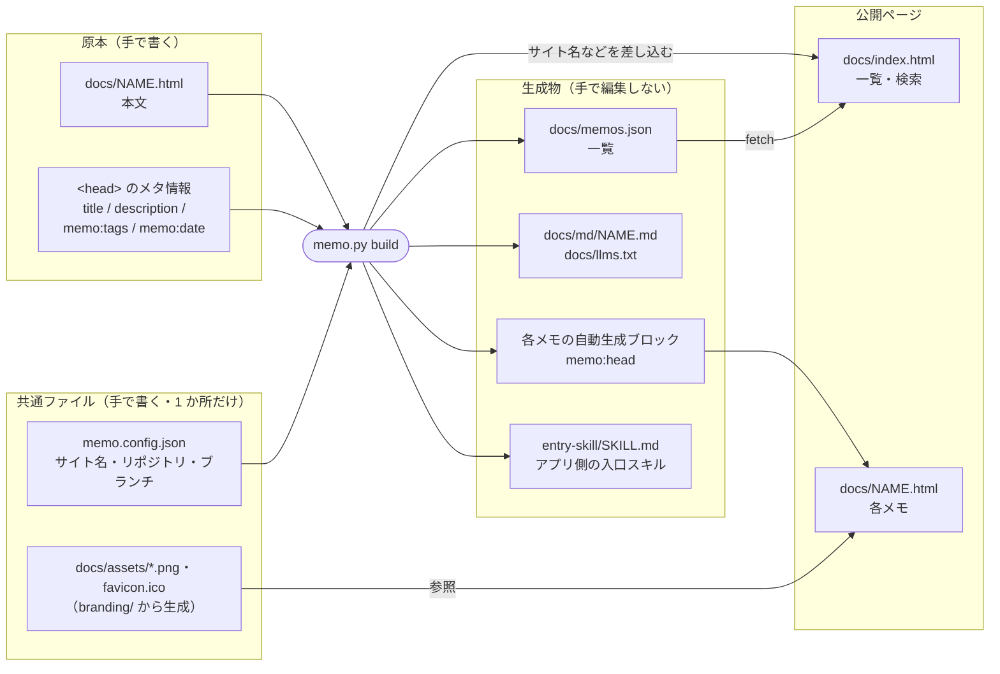
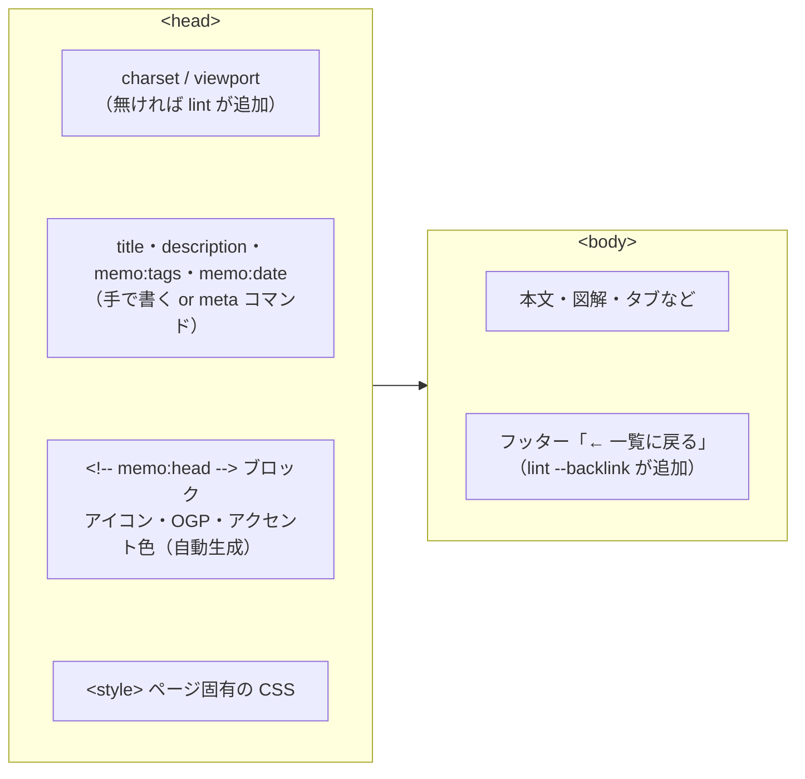
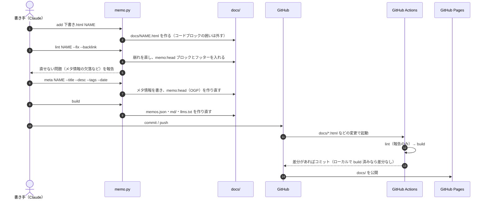
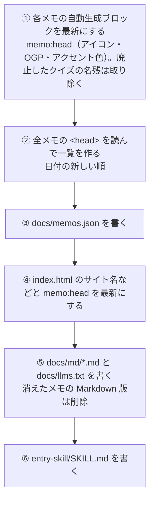
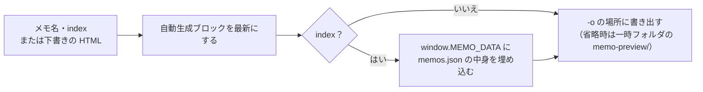
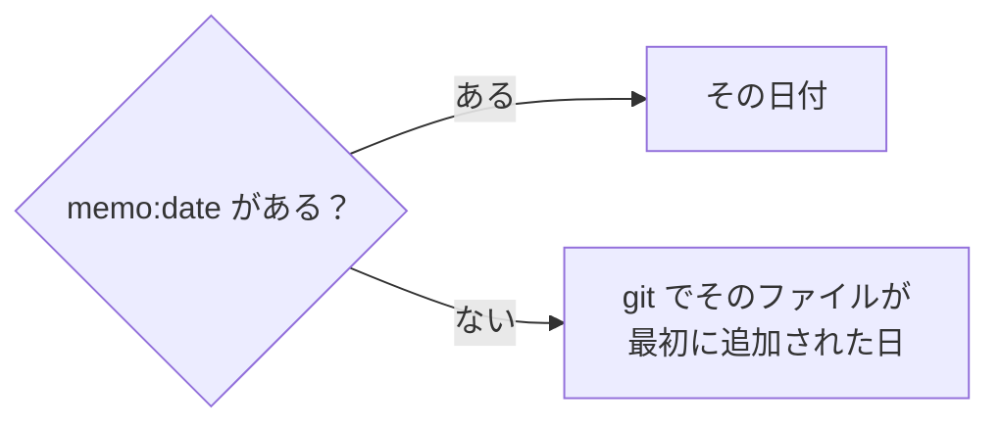
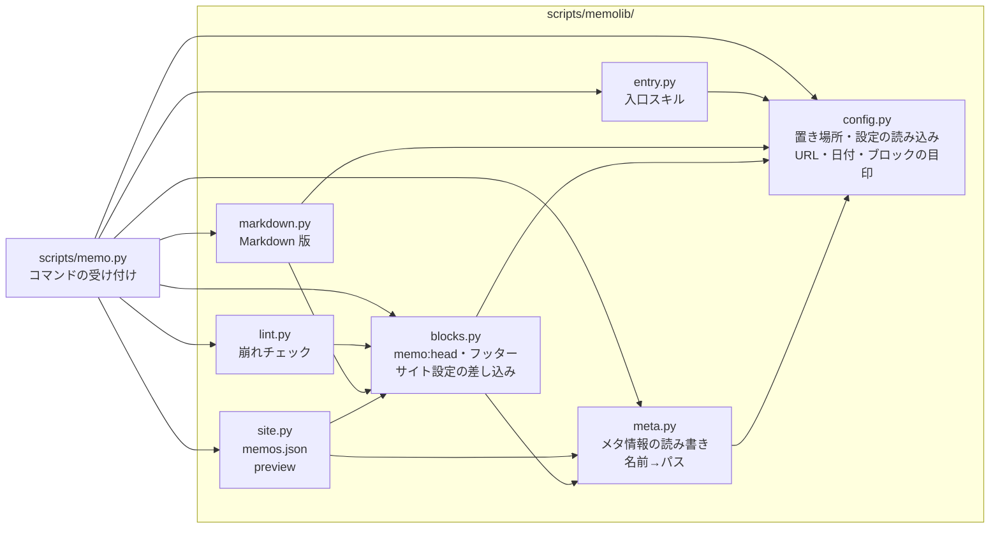

# memo.py の仕組み

`scripts/memo.py` は、MEMO リポジトリのメモ（`docs/*.html`）を登録・点検し、一覧や AI 向けの Markdown 版を生成するツールです。
入口は `scripts/memo.py`、処理の本体は `scripts/memolib/` にあり、テストは `tests/` にあります。
標準ライブラリだけで動き、どのディレクトリから実行してもかまいません。

使い方の入口は [README](README.md)、ページのデザイン規約は [memo-style](.claude/skills/memo-style/SKILL.md)、登録の手順は [memo-publish](.claude/skills/memo-publish/SKILL.md) にあります。このファイルは「スクリプトが何をどこに書くか」の説明です。

## 目次

- [基本の考え方](#基本の考え方)
- [全体像：原本と生成物](#全体像原本と生成物)
- [メモ 1 本の中身](#メモ-1-本の中身)
- [コマンド一覧](#コマンド一覧)
- [登録の流れ](#登録の流れ)
- [各コマンドの詳細](#各コマンドの詳細)
- [自動生成ブロック](#自動生成ブロック)
- [AI 向けの Markdown 版](#ai-向けの-markdown-版)
- [サイトごとの設定（memo.config.json）](#サイトごとの設定memoconfigjson)
- [日付と URL の決まり方](#日付と-url-の決まり方)
- [表示の確認とプレビュー](#表示の確認とプレビュー)
- [GitHub Actions](#github-actions)
- [コードの構成とテスト](#コードの構成とテスト)
- [変更したいときはどこを触るか](#変更したいときはどこを触るか)
- [このキットから始める](#このキットから始める)

## 基本の考え方

- **原本は人（または Claude）が書く。それ以外はすべて生成する。** 原本は各メモの本文と `<head>` のメタ情報の 2 つだけで、一覧や Markdown 版、各ページに差し込むタグはスクリプトが作ります。生成されたものは手で編集しません（次の `build` で上書きされます）。
- **サイトごとの値は `memo.config.json` だけに書く。** サイト名・リポジトリ・ブランチ・タイムゾーンをコードやスキル、ページに直接書きません（[サイトごとの設定](#サイトごとの設定memoconfigjson)）。
- **置き場所を知っているのはスクリプトだけ。** メモは名前（`docker` など）で指定し、パスは `memo.py path NAME` で引きます。スキル側でパスを組み立てません。
- **公開されるのは `docs/` だけ。** GitHub Pages の公開元が `docs/` なので、スクリプト・スキル・このファイルは公開されません。

## 全体像：原本と生成物



| ファイル | 種類 | 作る人 | 中身 |
| --- | --- | --- | --- |
| `docs/NAME.html` | メモ | 人＋スクリプト | 本文とメタ情報は人が書く。`memo:head` ブロックはスクリプトが入れる |
| `docs/index.html` | トップページ | 人＋スクリプト | 一覧・検索・タグ絞り込み。データは `memos.json` から読む。サイト名・説明・リポジトリへのリンクは `build` が `memo.config.json` から入れる |
| `memo.config.json` | 設定 | 人 | サイト名・説明・リポジトリ・ブランチ・タイムゾーン |
| `entry-skill/SKILL.md` | 生成物 | `build` | claude.ai のアプリ側に置く入口スキル（リポジトリ名とブランチ入り） |
| `docs/memos.json` | 生成物 | `build` | 全メモのタイトル・説明・タグ・日付 |
| `docs/md/NAME.md` | 生成物 | `build` | 各メモの本文を Markdown にしたもの |
| `docs/llms.txt` | 生成物 | `build` | 全メモの目次（Markdown 版へのリンク） |
| `docs/assets/*.png`・`favicon.ico` | 共通ファイル | `branding/render.py` | アイコンと OGP 画像 |
| `.claude/skills/memo-style/template.html` | テンプレート | 人 | `new` で新しいメモを作るときの雛形 |

## メモ 1 本の中身



一覧に載る情報は `<head>` から読みます。

```html
<title>Docker 動作原理</title>
<meta name="description" content="1 文の説明">
<meta name="memo:tags" content="Docker, Linux">
<meta name="memo:date" content="2026-10-31">
```

- タイトルは `<meta name="memo:title">` があればそちらを優先し、無ければ `<title>`、それも無ければファイル名。
- タグはカンマ区切り。表記ゆれを防ぐため、既存のタグ（`memo.py list` で見られる）を使い回します。
- 日付の決まり方は[日付と URL の決まり方](#日付と-url-の決まり方)を参照。

## コマンド一覧

```bash
python3 scripts/memo.py <コマンド> ...
```

| コマンド | 使い方 | やること | ファイルを書き換えるか |
| --- | --- | --- | --- |
| `new` | `new NAME` | テンプレートから `docs/NAME.html` を作る | 作る |
| `add` | `add SRC NAME [--force]` | 外部の HTML を `docs/NAME.html` として取り込む | 作る（`--force` で上書き） |
| `path` | `path NAME [--md]` | メモ（または Markdown 版）の絶対パスを表示 | しない |
| `url` | `url [NAME]` | 公開 URL を表示 | しない |
| `lint` | `lint MEMO... [--fix] [--backlink]` | 崩れのチェック。`--fix` で直せるものを直す | `--fix` のときだけ |
| `meta` | `meta MEMO [--title] [--desc] [--tags] [--date]` | メタ情報を設定する | する |
| `build` | `build [--check]` | 生成物をすべて作り直す。`--check` は古いかどうかだけ調べる | `--check` 以外はする |
| `list` | `list` | メモの一覧（日付・名前・タイトル・タグ）を表示 | しない |
| `preview` | `preview MEMO\|index\|FILE [-o OUT]` | 自動生成ブロックを最新にし、トップページなら一覧データを埋め込んだ 1 枚の HTML を書き出す | 元のファイルはしない |

`MEMO` / `NAME` は `docker`・`docker.html`・`docs/docker.html` のどれでもよく、既存のファイルパスを渡せばそのファイルが対象になります（下書きの点検に使えます）。
名前は英小文字・数字・ハイフンだけで、`index` はトップページなのでメモ名に使えません。

## 登録の流れ

[memo-publish](.claude/skills/memo-publish/SKILL.md) の手順を、スクリプトの動きで見るとこうなります。



GitHub の画面から HTML を直接アップロードした場合も、Actions の `build` が自動生成ブロックと一覧を作るので、一覧に載ります。

## 各コマンドの詳細

### new / add

- `new` は `.claude/skills/memo-style/template.html` をコピーするだけです。同名のファイルがあれば止まります。
- `add` は外部の HTML を取り込みます。Markdown のコードブロック（```` ```html ... ``` ````）に包まれていれば中身だけを取り出します。同名のファイルがあれば止まり、`--force` で上書きします。
- メモと取り込む HTML は UTF-8 で読みます。UTF-8 で読めないファイル（Shift_JIS など）があると、どのコマンドでもそのファイル名を示して止まります。

### lint

`lint` は「自動で直せるもの」と「人が直すもの（`[要対応]`）」を分けて報告します。`--fix` を付けたときだけ書き込みます。

| 分類 | 内容 |
| --- | --- |
| 直す | `<style>` 内の全角クォート `‘’“”`（コピペで化けて font-family などが効かなくなる） |
| 直す | `* {` が `- {` や `\*` に化けたもの（Markdown 経由のコピペで起きる） |
| 直す | `<!DOCTYPE html>`・charset・viewport の欠落 |
| 直す | フッターの「← 一覧に戻る」リンク（`--backlink` のとき。無ければ追加） |
| 直す | `memo:head` ブロック（アイコン・OGP）の追加／更新 |
| 直す | 廃止した確認クイズの名残（`memo:quiz` ブロックと `id="memo-quiz"` の問題データ）の削除 |
| 報告 | JS 内で全角クォートが文字列の区切りに使われている疑い |
| 報告 | タイトル・説明・タグ・日付の欠落 |
| 報告 | 一覧へのリンクが無い（`--backlink` を付けていないとき） |

終了コードは、報告が残るか、`--fix` なしで直せるものがあれば 1、それ以外は 0 です。

### meta

指定した項目だけを書き換え、最後に自動生成ブロックを作り直します（OGP のタイトル・説明が新しいメタ情報に追従します）。

- `--tags` はカンマ区切りで渡し、前後の空白を整えて保存します。
- `--date` は値を付ければその日付（`YYYY-MM-DD`。形式やありえない日付はエラー）、値なしなら**設定のタイムゾーン（`utc_offset_hours`）の今日**です（[日付と URL の決まり方](#日付と-url-の決まり方)）。

### build

`build` は次の順に処理します。どれも「内容が変わったときだけ」書き込みます。



- `memo.config.json` の `repository` が空・`owner/name` の形でない・テンプレートの値（`repo/sample`）のままのときは、最初に警告を出します（止めずに続けます）。入口スキルの clone 先や公開 URL がおかしくなるのを防ぐためです。
- `--check` は何も書き込まず、古いファイルがあれば名前を表示して終了コード 1 を返します。

### list / path / url

- `list` は `日付  ファイル名  タイトル  [タグ]` の形で全メモを表示します。
- `path NAME` は `docs/NAME.html` の絶対パス、`--md` を付けると `docs/md/NAME.md` のパスを表示します。
- `url NAME` は公開 URL を表示します（名前なしならトップ）。

### preview

トップページは一覧データ（`memos.json`）を読み込むので、HTML 1 枚だけを渡す場面（会話内のプレビューなど）では一覧が出ません。`preview` は自動生成ブロックを最新にし、トップページならデータを埋め込んだコピーを書き出します。元のファイルは変更しません。



トップページは、`window.MEMO_DATA` があればそれを使い、無ければ `memos.json` を fetch します。

## 自動生成ブロック

各ページに差し込まれるブロックです。開始と終了のコメントで囲まれていて、毎回まるごと作り直されるので、中を手で編集しても消えます。

| ブロック | 入る場所 | 中身 | 作るもの |
| --- | --- | --- | --- |
| `<!-- memo:head -->` 〜 `<!-- /memo:head -->` | `</head>` の直前 | ファビコン・iOS アイコン・OGP（`og:title` / `og:description` は title / description から）、アクセント色（`branding.accent`・`accent_light`） | `lint`・`meta`・`build`・`preview` |
| `data-memo-site` の付いた要素・属性 | `index.html` の書いた場所 | `memo.config.json` の値（[サイトごとの設定](#サイトごとの設定memoconfigjson)）。目印の属性は残る | `build`・`preview` |
| `<footer id="memo-backlink">` | `</body>` の直前 | 「← 一覧に戻る」リンク。スタイルはインラインで完結 | `lint --backlink`（無いときだけ追加） |

## AI 向けの Markdown 版

`build` は Claude などが HTML（CSS・SVG 込みで重い）を読まずに中身を把握できるよう、本文を Markdown にした版を作ります。

| 出力 | 中身 |
| --- | --- |
| `docs/llms.txt` | 全メモの目次。タイトル・説明・タグ・日付と、各 Markdown 版へのリンク |
| `docs/md/NAME.md` | 冒頭にタイトル・説明・URL・タグ・日付、続けて本文 |

変換のルール:

- `<head>`・CSS・JS・フッターは除きます。
- SVG の図は、中の文字（ラベル）だけを残します。
- 図や操作できるパーツがある節には、元のページのその節へのリンクを付けます。
- 本文の大半を JavaScript のデータから描画するページは、HTML からは中身が取れないので、そのスクリプトをコードブロックとして末尾に付けます。
- 別のメモへのリンクは、そのメモの Markdown 版へのリンクに置き換えます。

公開 URL は `python3 scripts/memo.py url` の後ろに `llms.txt` を付けたもの（例: `https://alice.github.io/notes/llms.txt`）です。リポジトリを繋いでいない会話でも、この URL を渡せば Claude が過去のメモを参照できます。

## サイトごとの設定（memo.config.json）

サイトごとに変わる値は、リポジトリ直下の `memo.config.json` に 1 か所だけ書きます。コード・スキル・ページはここから読むので、別のリポジトリで使うときもこのファイルと `docs/CNAME` を変えれば済みます。

| 項目 | 使われる場所 | 既定値 |
| --- | --- | --- |
| `site_name` | 各ページの OGP・iOS アイコン名、トップページの `<title>`・見出し、`llms.txt` の見出し、入口スキルの説明、アイコン・OGP 画像の文字 | `MEMO` |
| `description` | トップページの説明（本文と `<meta name="description">`、OGP）、OGP 画像の説明文 | 空 |
| `llms_description` | `llms.txt` の冒頭の説明（空なら書かない） | 空 |
| `repository` | トップページのリンク、`docs/CNAME` が無いときの公開 URL、入口スキル（clone 先・スキル名） | 空（`build` が警告） |
| `branch` | スキルの push 先（`python3 scripts/memo.py config branch` で読む）、入口スキルの raw URL | `main` |
| `utc_offset_hours` | `meta --date` の「今日」 | `0`（日本なら `9`） |
| `branding` | 全ページのアクセント色（`memo:head` に入る）と、アイコン・OGP 画像（`branding/render.py`）。下の表 | `{}` |

`branding` の中の項目（空欄はほかの設定から埋まります）:

| 項目 | 使われる場所 | 空のとき |
| --- | --- | --- |
| `title` | OGP 画像の大きな文字（長ければ縮めて、それでも入らなければ … で切る） | `site_name` |
| `tagline` | OGP 画像の説明文（2 行まで） | `description` |
| `url` | OGP 画像に小さく出す URL | 公開 URL のホスト名とパス |
| `mark` | アイコンの文字（1〜2 文字がおすすめ） | `title` の先頭 1 文字 |
| `accent` | ダークモードのページの `--accent`（見出し・強調・リンク）と、`theme: dark` の画像の色（題字・余白線・ペン）。`#rgb` か `#rrggbb` | 空にはできない（既定 `#00d4ff`） |
| `accent_light` | ライトモードのページの `--accent` と、`theme: light` の画像の色 | `accent` を白地とのコントラスト比 4.5 以上になるまで暗くした色 |
| `theme` | 画像のテーマ。`dark` か `light`（ページはライト・ダークの両方に自動で対応） | `dark` |

- 書き間違い（JSON の書式、文字列であるべき項目に数値、`site_name`・`branch` が空、`utc_offset_hours` が -24〜24 の外など）は、項目名と直し方を示して止まります（traceback は出しません）。
- 書かなかった項目は既定値（`scripts/memolib/config.py` の `DEFAULTS`・`BRANDING_DEFAULTS`）になります。知らない項目や、`accent`・`accent_light`・`theme` のおかしな値があるとエラーで止まります（綴りの間違いに気づけるように）。
- アクセント色は `build` が全ページの `memo:head` に `<style id="memo-accent">` として入れます。各ページの `:root` の `--accent` より強い `html:root` で書くので、ページ側の値（テンプレートの既定値）は上書きされます。
- `branding` を変えても `build` だけでは画像は変わりません。`python3 branding/render.py` で作り直します（[日付と URL の決まり方](#日付と-url-の決まり方) の「URL」）。
- `python3 scripts/memo.py config` で今の設定（と公開 URL）を表示できます。

**トップページへの差し込み**

`docs/index.html` のサイト名などは手で書かず、目印の属性を付けておくと `build` が設定の値で書き換えます。書式の中では `{site_name}`・`{description}`・`{repository}` が使えます。

```html
<h1 data-memo-site="{site_name}">MEMO</h1>                       <!-- 中身のテキストを置き換える -->
<a href="…" data-memo-site-href="https://github.com/{repository}">  <!-- href 属性を置き換える -->
<meta name="description" content="…" data-memo-site-content="{description}">  <!-- content 属性を置き換える -->
```

目印の属性は残るので、何度 `build` しても同じ結果になります。中身がテキストだけの要素に使います（子要素があると中身ごと置き換わります）。

**アプリ側の入口スキル**

claude.ai のアプリに置く入口スキルは「このリポジトリを取ってきて、ここのスキルに従う」だけのものです。リポジトリ名とブランチだけはアプリ側で知っている必要があるので、`build` が設定から `entry-skill/SKILL.md` を作ります。設定を変えたら、これをアプリ側のスキルに貼り直します。

スキル名はリポジトリ名から作ります。スキル名に使えるのは小文字・数字・ハイフンだけなので、大文字は小文字に、それ以外の文字（`.` `_` など）はハイフンにします（`Alice/My.Notes` → `my-notes`、`alice/alice.github.io` → `alice-github-io`。64 文字まで）。clone 先のフォルダ名はリポジトリ名のままです。

## 日付と URL の決まり方

**日付（`memo:date`）**



- `meta --date` を値なしで実行すると、**`memo.config.json` の `utc_offset_hours` のタイムゾーンでの今日**が入ります（日本なら 9）。実行環境の時計が UTC でも、たとえば日本時間の朝 9 時前に前日の日付になることはありません。
- `meta --date 2026-11-04` のように値を付ければその日付になります。
- 登録後は `memo.py list` で日付を確認します。

**URL**

- 公開 URL は `docs/CNAME` の独自ドメインから決まります（無ければ `memo.config.json` の `repository` から GitHub Pages の URL `https://OWNER.github.io/REPO/` を作ります）。`og:url`・`og:image` の絶対 URL にも使います。
- `og:image` には `og.png` の中身から作った短いハッシュ（`?v=…`）を付けます。画像を差し替えると URL が変わり、SNS 側の画像キャッシュが古いまま残るのを防げます。
- アイコンと OGP 画像の生成元は `branding/`（`og.html`・`icon.html`・`leaf.css`）で、`python3 branding/render.py` で `docs/assets/` に書き出します（`branding/` は公開されません）。文字と色は `memo.config.json`（`site_name`・`description`・公開 URL と `branding`）から差し込むので、HTML を直接書き換える必要はありません。
- `render.py` だけは標準ライブラリでは動きません（playwright と chromium、Pillow、フォント Noto Sans CJK JP / DejaVu Sans Mono が必要。README の「必要なもの」）。Actions では動かさないので、設定を変えたら手元で実行し、できた画像をコミットします。`og.png` が変わると、次の `build` で `og:image` の `?v=` が更新されます。

## 表示の確認とプレビュー

各メモは 1 枚で完結していますが、トップページは `memos.json` を読み込むので、開き方によって表示が変わります。

| 開き方 | 各メモ | トップの一覧 |
| --- | --- | --- |
| 公開サイト（GitHub Pages） | 出る | 出る |
| ローカルサーバー `python3 -m http.server -d docs` | 出る | 出る |
| `memo.py preview` で作った 1 枚 | 出る | 出る |
| HTML ファイルを直接開く・そのまま会話に送る | 出る（自動生成ブロックが古い場合はそのまま） | 「読み込めませんでした」と表示 |

会話内で下書きを見せるときの手順は [memo-style の「会話内でプレビューするとき」](.claude/skills/memo-style/SKILL.md) にあります。

```bash
python3 scripts/memo.py lint 下書き.html --fix --backlink
python3 scripts/memo.py preview 下書き.html -o /tmp/NAME.html
```

## GitHub Actions

`.github/workflows/build-index.yml` が、デフォルトブランチへの push で生成物を作り直します（ブランチ名はワークフローに書いていないので、`main` でも `master` でも動きます）。

| 項目 | 内容 |
| --- | --- |
| 起動する変更 | `docs/*.html`・`docs/CNAME`・`scripts/` 以下・`docs/assets/og.png`・`memo.config.json`（手動実行も可） |
| 手順 | 履歴ごと checkout（日付の推定に使う）→ 全メモを `lint`（報告のみ。メモが 0 本なら省略）→ `build` |
| コミット | `docs/`・`entry-skill/` に変更（新しく生成されたファイルを含む）があれば `Rebuild MEMO index` としてコミット・push |
| 同時実行 | 同じブランチの実行は 1 本ずつ順番に動く（`concurrency`。途中で止めない） |
| push の競合 | build 中に別の push が来てこちらの push が拒否されたら、最新を取り込んで `build` し直し、もう一度 push する（最大 3 回。それでもだめなら失敗にする） |

ローカルで `build` してから push していれば、Actions 側では差分が出ません。

もう 1 つの `.github/workflows/test.yml`（`Test memo.py`）は、`scripts/`・`tests/`・トップページ・`memo.config.json`・テンプレートが変わったとき（どのブランチでも、PR も含む）にテストを流します。リポジトリは書き換えません。

## コードの構成とテスト

入口の `scripts/memo.py` はコマンドを受け付けるだけで、処理の本体は `scripts/memolib/` に役割ごとに分かれています。
コードを直すときの手順（テストの流し方、出力が変わっていないことの確かめ方、更新するドキュメント）は [memo-maintain](.claude/skills/memo-maintain/SKILL.md) にあります。



矢印は「使っている」向きです。依存は一方向（`config` ← `meta` ← `blocks` ← `lint`・`markdown`・`site` ← `memo.py`、`config` ← `entry` ← `memo.py`）で、逆向きの import はありません。

| ファイル | 役割 | 主な関数 |
| --- | --- | --- |
| `scripts/memo.py` | コマンドの受け付け | `cmd_build`・`cmd_lint`・`cmd_preview` など、`main` |
| `memolib/config.py` | 置き場所・`memo.config.json` の読み込み・公開 URL・日付・自動生成ブロックの目印 | `load_config`・`today`・`site_url`・`pages_url`・`asset_version` |
| `memolib/meta.py` | `<head>` のメタ情報の読み書き、名前からパスへの解決 | `read_meta`・`set_meta`・`memo_path`・`memo_files` |
| `memolib/blocks.py` | 自動生成ブロック、サイト設定の差し込み、「一覧に戻る」フッター、廃止したクイズの片付け | `head_block`・`apply_site`・`apply_generated`・`strip_quiz` |
| `memolib/entry.py` | アプリ側の入口スキルの中身 | `entry_skill` |
| `memolib/lint.py` | 崩れのチェックと自動修正 | `lint_text` |
| `memolib/markdown.py` | AI 向けの Markdown 版 | `html_to_markdown`・`memo_markdown`・`llms_txt`・`build_markdown` |
| `memolib/site.py` | 一覧の JSON、会話内プレビュー用の 1 枚の HTML | `site_data`・`memos_json`・`preview_text` |

多くの関数は「HTML の文字列を受け取って文字列を返す」だけで、ファイルを書き換えるのは `memo.py` の各コマンドです。そのため関数単位でテストできます。

### テスト

標準ライブラリの `unittest` だけで動きます。一時フォルダに作った「作業用リポジトリ」で動かすので、リポジトリ自体は書き換えません。

ほとんどのテストは、仕組みのファイル（`scripts/`・テンプレート・`docs/` の `index.html`・`assets/`）に `tests/fixtures/` のサンプルのメモ 2 本と設定を組み合わせて動きます。本物のメモが 1 本もない（仕組みだけを取り出した）リポジトリでも通ります。本物のメモを確かめるテスト（コミット済みの生成物が最新か、全メモが lint を通るか）は、メモがあるときだけ動きます。

```bash
python3 -B -m unittest discover -s tests       # 全部（15 秒ほど）
python3 -B tests/snapshot.py OUTDIR            # 全コマンドの出力を保存（前後比較用。メモがなければサンプルで）
```

| ファイル | 中身 |
| --- | --- |
| `tests/test_cli.py` | コマンドを外から動かす結合テスト。生成物を全部消して `build` すると同じ中身に戻るか、2 回目の `build` で何も変わらないか、`memo.config.json` を変えるとページ・入口スキル・URL が変わるか、`lint --fix`・`new`・`add`・`meta`・`preview`・`config` の動きなど。`RepositoryTest` だけは本物のメモで、コミット済みの生成物が最新か・全メモが lint を通るかを見る |
| `tests/test_units.py` | 関数ごとの単体テスト。設定の読み込みとタイムゾーンの日付、サイト設定の差し込み、ブロックの差し込み位置と冪等性、廃止したクイズの片付け、CSS の化けの修正、Markdown 変換など |
| `tests/snapshot.py` | テストではなく道具。全メモの `build`・`lint`・`preview` と各コマンドの出力をフォルダに保存する。リファクタリングの前後で 1 回ずつ実行し、`diff -r` で何も出なければ出力は変わっていない |
| `tests/helpers.py` | 「作業用リポジトリ」を作る共通処理（`Workspace()` はサンプル、`Workspace(real=True)` は本物のメモ） |
| `tests/fixtures/` | テスト用のサンプルのメモ（`docs/`）と設定（`memo.config.json`） |

## 変更したいときはどこを触るか

| 変えたいもの | 触るファイル | その後 |
| --- | --- | --- |
| メモの本文 | `docs/NAME.html` | `lint NAME` → `build` |
| タイトル・説明・タグ・日付 | `meta NAME ...` | `build` |
| アイコン・OGP のタグ | `memolib/blocks.py` の `head_block` | `build`（全ページが書き換わる） |
| サイトのアクセント色 | `memo.config.json` の `branding.accent`・`accent_light` | `python3 branding/render.py` → `build`（全ページが書き換わる） |
| アイコン・OGP 画像の文字・色 | `memo.config.json`（`site_name`・`description`・`branding`） | `python3 branding/render.py` → `build` |
| アイコン・OGP 画像のデザイン | `branding/`（`og.html`・`icon.html`・`leaf.css`、テーマの色は `render.py` の `THEMES`） | `python3 branding/render.py` → `build` |
| トップページの見た目 | `docs/index.html` | 何もしなくてよい（サイト名などを入れる場所を増やしたら `build`） |
| サイト名・説明・リポジトリ・ブランチ・タイムゾーン | `memo.config.json` | `build`（全ページ・入口スキルが書き換わる。入口スキルはアプリ側にも貼り直す） |
| 一覧に載せる項目 | `memolib/meta.py` の `read_meta`、`memolib/site.py` の `memos_json` | `build` |
| Markdown 版の変換ルール | `memolib/markdown.py` の `_ToMarkdown`・`html_to_markdown` | `build`（全 Markdown 版が書き換わる） |
| 新しいメモの雛形 | `.claude/skills/memo-style/template.html` | 何もしなくてよい |
| 公開ドメイン | `docs/CNAME` | `build`（OGP の URL が変わる） |
| 上の表にないスクリプトの処理 | `scripts/memolib/` の該当モジュール（[コードの構成とテスト](#コードの構成とテスト)） | [memo-maintain](.claude/skills/memo-maintain/SKILL.md) の手順でテストと前後比較 |


## このキットから始める

メモ（中身）と仕組みは分けてあり、仕組みは本物のメモがなくても動きます。テンプレートから作ったリポジトリでは、サンプルのメモと生成物を消して設定を書き換えれば自分のサイトになります（README の「はじめかた」と同じ手順の詳細です）。

**仕組み（残すもの）**

| 場所 | 中身 |
| --- | --- |
| `scripts/`・`tests/`（`tests/fixtures/` を含む） | `memo.py` とテスト |
| `.claude/skills/` | スキルとメモの雛形 |
| `.github/workflows/` | 生成とテストのワークフロー |
| `docs/index.html`・`docs/assets/` | トップページ、アイコン |
| `branding/` | アイコンと OGP 画像の生成元 |
| `memo.config.json`・`README.md`・`memo-detail.md`・`LICENSE`・`.gitignore` | 設定・説明・ライセンス |

**サンプルの中身（消すもの）**

| 場所 | 中身 |
| --- | --- |
| `docs/` 直下の上記以外の `*.html` | サンプルのメモ（`sample.html`・`sample-plain.html`） |
| `docs/md/`・`docs/memos.json`・`docs/llms.txt`・`entry-skill/` | 生成物（`build` で作り直す） |

**手順**

```bash
# 1. サンプルのメモと生成物を消す
find docs -maxdepth 1 -name '*.html' ! -name index.html -delete
rm -rf docs/md docs/memos.json docs/llms.txt entry-skill
# 2. memo.config.json の site_name・description・llms_description・repository・branch・utc_offset_hours・branding を自分のリポジトリに合わせる
# 3. 作り直して確かめる
python3 branding/render.py                 # アイコン・OGP 画像を設定から作り直す（要: playwright など）
python3 scripts/memo.py build              # repository を書き換え忘れていると警告が出る
python3 -B -m unittest discover -s tests   # 本物のメモを見るテストは飛ばされる
```

あとは GitHub の設定（Pages の公開元・Actions の書き込み権限）を README の「はじめかた」のとおりにし、`entry-skill/SKILL.md` をアプリ側のスキルとして登録すれば、アプリからも使えます。
